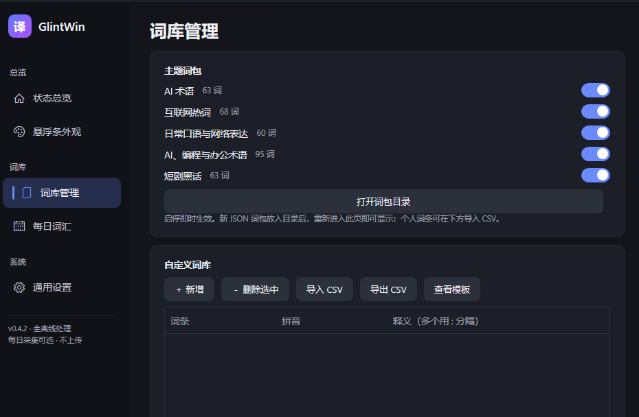
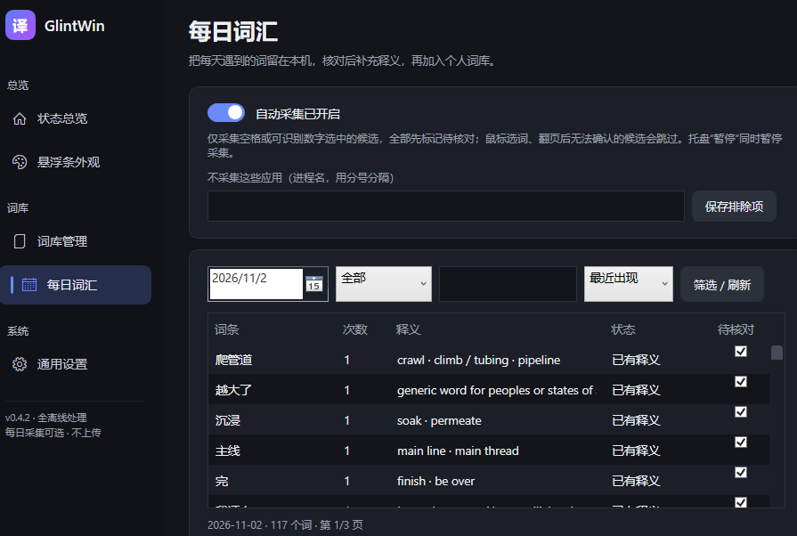

# GlintWin

**打字时，顺手学英文**

用搜狗或微软拼音打中文，候选栏下方实时浮出第一候选词的英文释义。
不换输入法、不改输入习惯、不联网。

Windows 10 2004+ / 11 · x64 · .NET 10 自包含单文件 · 内置 12 万条词典 · 全程离线

---

## 这是什么

输入 `jin'zhan` 时，候选栏下方跟着浮出一条小胶囊：`进展 — make headway · make progress`。它不接管输入、不弹窗打断，只是在你看候选词的那一眼，顺手给一个英文说法。

和 macOS 上的 [Glint](https://github.com/jsogn/Glint) 同一套产品思路，Windows 侧独立实现：候选词由**系统 OCR 从输入法候选窗读取**，释义查**本地 CC-CEDICT 词典**，中间不经过网络。

## 功能

| 能力 | 说明 |
|---|---|
| **悬浮释义** | 候选窗下方浮层显示第一候选的英文；取词典前两条释义、去掉 `to ` 前缀、以 ` · ` 连接 |
| **双输入法通道** | 搜狗走候选窗口锚定（全应用可用）；微软拼音走「键序追踪 + 光标锚定 + 光标下方条带 OCR」，搜狗可见时自动让位 |
| **12 万条离线词典** | CC-CEDICT 基础库 + 5 个主题词包：互联网热词 68 / AI 术语 63 / 短剧黑话 63 / 日常表达 60 / AI·编程·办公 95 |
| **自定义词库** | 界面表格增删改、CSV 导入导出；自定义词条优先级最高，保存即生效 |
| **跟随皮肤配色** | 悬浮条底色/文字/字号采样自候选行像素；9 组预设一键换肤，或用 HSV 取色器自定义；不透明度 40–100 可调 |
| **每日词汇（可选）** | 默认关闭。开启后本地记录当天输入过的词，按日期/状态筛选、逐条核对，确认后一键加入自定义词库 |
| **轻量不打断** | 悬浮条 `NOACTIVATE` + 鼠标穿透，绝不抢焦点；40 ms 轮询、像素哈希去重、首帧双确认与指数平滑防闪烁 |
| **全离线** | 无网络代码、不注入进程、不读正文、不落盘原始按键 |

## 三步上手

| 步骤 | 做什么 |
|---|---|
| **01 打开工具** | 下载单文件 EXE，双击运行。托盘出现「译」图标即就绪。 |
| **02 正常打字** | 照常用搜狗 / 微软拼音输中文，不用切换任何模式。 |
| **03 看英文释义** | 候选栏下方浮出胶囊，显示当前第一候选的英文。 |

## 下载与运行

从 [Releases](https://github.com/fengwuyun/GlintWin/releases/latest) 下载 `GlintWin-v*-win-x64.exe`（约 183 MB，内含 .NET 10 运行时、基础词典与词包），双击即用，**免安装**。

| 项 | 要求 |
|---|---|
| 系统 | Windows 10 2004（19041）/ Windows 11，x64 |
| 输入法 | 搜狗输入法（完整支持）；微软拼音（已支持，见限制） |
| 系统组件 | **Windows 中文 OCR 语言包**（中文系统默认自带；缺失时状态总览会提示） |
| 权限 | 普通用户即可；管理员权限窗口无法截图，故不支持 |

首次运行把内置资源释放到 `%LOCALAPPDATA%\GlintWin\`；开机自启可把快捷方式放进 `shell:startup`，或在「通用设置」一键开；托盘右键「打开主界面 / 暂停 / 退出」。

## 主界面

深色 Fluent 风格控制台，托盘「打开主界面」进入，左侧五页：

| 页 | 内容 |
|---|---|
| 状态总览 | 双通道监控状态、OCR 是否就绪、词典构成、已启用词包 |
| 悬浮条外观 | 取色模式、9 组预设、HSV 取色器、不透明度滑杆、实时透底预览 |
| 词库管理 | 主题词包开关（即时重载）、自动发现新词包、自定义词库表格与 CSV |
| 每日词汇 | 自动采集开关、按日期/状态/文本筛选、逐条核对保存 |
| 通用设置 | 开机自启、诊断入口、关于 |

### 界面预览

| 词库管理 | 每日词汇 |
|---|---|
|  |  |

配置即时写入 `%LOCALAPPDATA%\GlintWin\config.json`；词典、词包、自定义词库与日志同目录，字段与数据结构见 [技术说明](docs/TECHNICAL.md)。

**扩词库三种方式**：界面表格增删改（保存即生效）、CSV 导入（列 `词条,拼音,释义1[,释义2,释义3]`）、或把 `{"词":{"p":"拼音","s":["释义"]}}` 格式的 JSON 丢进 `Data/Packs/`。

## 支持范围与已知限制

- **搜狗输入法**：完整支持（窗口锚定，全应用可用）。
- 释义只取**第一候选**（高亮项），跟随翻页选中项在路线图上；管理员权限窗口受会话隔离限制，无法截图，暂不支持。

## 参考与致谢

- **[jsogn/Glint](https://github.com/jsogn/Glint)** — 本项目的灵感与产品原型来源。原版是 macOS 原生应用（Swift / AppKit），直接读输入法候选；Windows 侧无法复用其平台层，因此 GlintWin 是**独立实现**：候选词改由系统 OCR 从候选窗像素读取，释义改为查本地词典。交互形态与「顺手学英文」的产品判断沿用自上游。
- **[CC-CEDICT](https://cc-cedict.org/)** — 基础词典数据来源（CC-BY-SA 4.0）。
- **Windows.Media.Ocr** — 系统 OCR 引擎，候选词识别全部在本地完成。
- **[.NET 单文件发布](https://learn.microsoft.com/dotnet/core/deploying/single-file/)** — 免安装分发的实现方式。

## 版本记录

| 版本 | 要点 |
|---|---|
| [v0.4.2](docs/RELEASE-0.4.2.md) | 稳定初始定位（双帧确认 + 输入轮次作废旧坐标）；新增日常表达 / AI·编程·办公两个词包；词库页自动发现新词包 |
| [v0.4.1](docs/RELEASE-0.4.1.md) | 词典常驻内存 35.50 → 23.72 MiB（-33%）；精确查词零重复分配 |
| [v0.4](docs/RELEASE-0.4.md) | 悬浮条位置去抖；可选每日词汇收集箱；单文件 EXE 内置运行时与词典 |

更多文档：[PRD](docs/PRD.md) · [技术说明](docs/TECHNICAL.md) · [开发计划](docs/PLAN.md) · [验收清单](docs/ACCEPTANCE.md)
